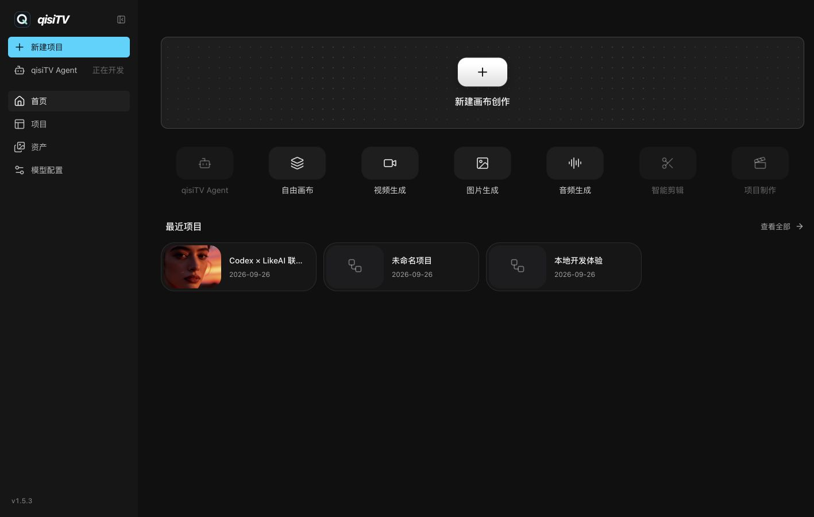

[简体中文](README.md) · [English](README.en.md)

<p align="center">
  
</p>

<h1 align="center">qisiTV</h1>

<p align="center"><strong>本地优先 · 轻量 · AI Native</strong></p>

<p align="center">
  面向 AI 视频创作的自由画布。<br>
  在 Codex 等本地 Agent 中对话，在画布里组织素材、模型与生成结果。
</p>

<p align="center">
  <a href="#产品演示">产品演示</a> ·
  <a href="docs/content/docs/overview/features.mdx">功能清单</a> ·
  <a href="QUICKSTART.md">开始使用</a> ·
  <a href="CONTRIBUTING.md">参与贡献</a>
</p>

qisiTV 基于开源项目 [BeefTV](https://github.com/glanderness/BeefTV) 二次开发，项目、画布、素材和任务默认保存在本机。

## 产品演示



[观看上游产品演示视频](https://github.com/user-attachments/assets/94fe6a39-6933-44b3-a9a9-dbc28b2d284c)（展示上游界面，qisiTV 以本仓库截图为准）。

## 一个画布，完整创作链路

- **生成**：从提示词或参考素材生成文字、图片、视频与音频，支持 LikeAI 渠道。
- **组织**：用节点、连线、框选、缩放和小地图建立素材关系与创作流程。
- **加工**：继续裁切、标注、局部重绘、拆分、引用和组合结果。
- **迭代**：保留过程、复用素材，让一次生成变成可继续编辑的工作流。
- **本地 Agent**：通过 MCP 或 `qisitv` CLI 在 Codex 等工具中操作画布、导入素材和回填结果。

qisiTV 同时提供项目库、个人资产库、异步任务、模型渠道和创作工具。完整范围见[功能清单](docs/content/docs/overview/features.mdx)。生成失败时展示原因与调整建议，对提交状态不确定的任务限制直接重试，避免重复提交。

## 工作方式

```text
想法 / 参考素材 → 本地 Agent 对话 / 手动操作
                         ↓
                    qisiTV 自由画布
                         ↓
              模型 API + 创作工具 + 本地素材
                         ↓
              可编辑、可复用的图片 / 视频 / 分镜
```

## 开放与本地优先

- 保留独立的 qisi API 与官方 LikeAI 配置和密钥，模型费用由服务商收取。
- 项目、画布、素材与任务由统一工作区管理，数据可以本地保存和迁移。
- 基于 React、Go 与 Wails，模型协议和工作台能力可继续扩展。
- 本地 Agent 连接使用现有工作区，不另建数据库。见 [MCP 与 CLI 接入](docs/content/docs/backend/local-agent.mdx)及 [LikeAI 配置](docs/content/docs/backend/likeai.mdx)。

## 开始使用

网站版无需注册。新版源码采用「网页操作、本机引擎执行」：安装 qisiTV 本机引擎后，从网页唤起并确认配对，选择本机项目根目录。每个项目对应真实独立文件夹；画布、导入素材和生成结果由同一本机工作区持久化。独立项目目录与引擎数据库、缓存目录分别管理，网页缓存不是最终存储。

需要外部 Agent 时，在网页的「Agent」页选择 Codex、WorkBuddy、Claude Desktop / Code、OpenClaw、Hermes、CodeBuddy、Cursor、VS Code 或通用 MCP，生成独立授权的 `qisitv` 配置并合并到客户端原配置。Agent 与引擎必须运行在同一台电脑。`qisitv-connect open` 可独立启动和配对，不要求先安装 MCP。旧 `qisitv-web` 在新版引擎模式只负责启动、配对和会话发现；旧画布工具会要求改用原生 `qisitv`，不会写入另一份浏览器项目。

<details>
<summary>用过旧版 qisitv-web？查看升级步骤</summary>

1. 在用过的 Agent 客户端中停用旧 `qisitv-web` 连接，并关闭手动启动旧连接器的终端窗口。
2. 等待约 30 秒，让旧服务退出；如果上次异常退出，可能需要约 75 秒。
3. 打开新版 qisiTV 本机引擎，按网页提示完成连接。
4. 在网页的「qisiTV MCP」页选择自己的 Agent，按页面提示配置新的 `qisitv` 连接。

</details>

内置创作助手、技能、工作流和媒体能力复用上游运行时；付费生成仍需要明确授权，不因安装、配对或创建项目而自动收费。旧浏览器项目需按文件夹迁移流程明确接管，不能自动合并两份工作区。各平台安装包、模型与发布体验仍需验收；当前合同与验证范围见 [Web 本机引擎说明](docs/design/web-engine-contract.md) 和 [功能对齐设计](docs/design/web-feature-parity.md)。

本地开发需要 Bun 和 Go 1.25。在本仓库中打开两个终端：

先获取 qisiTV 源码：

```bash
git clone https://github.com/wyuzhi/qisiTV.git
cd qisiTV
```

```bash
# 终端一：后端
cd backend
CANVAS_BACKEND_ADDR=127.0.0.1:8080 \
CANVAS_BACKEND_DATA_DIR=../.local/project-workbench-debug \
go run ./cmd/server

# 终端二：前端
cd web
bun install --frozen-lockfile
bun run dev
```

打开 <http://localhost:3000>。前端默认将 `/api` 代理到 `http://127.0.0.1:8080`。首次使用时在设置中填写自己的 LikeAI API Key 并拉取模型；模型 API 的生成费用由供应商收取。

详细环境要求、Windows 构建与桌面发布方式见 [`QUICKSTART.md`](QUICKSTART.md) 和[桌面发布文档](docs/desktop-release.md)。

## 项目状态与安全

qisiTV 正在快速迭代，数据结构和外部接口仍可能变化。建议在个人设备或可信环境中使用，并避免将本地 workspace API 直接暴露到公网。不要提交 API Key、Cookie、数据库或本机配置。

- [更新记录](CHANGELOG.md)
- [安全策略](SECURITY.md)
- [贡献指南](CONTRIBUTING.md)

## 贡献与许可

欢迎提交 Issue 和 Pull Request。开发流程与测试要求见 [`CONTRIBUTING.md`](CONTRIBUTING.md)。

项目按照 [`LICENSE`](LICENSE) 发布；上游来源、保留声明与第三方归属见 [`NOTICE`](NOTICE)。

历史 MIT 内容及独立 qisiTV 贡献继续采用 MIT。v1.5.17 起选择适配的上游新增内容保留 [BeefTV Source Available License 1.0](licenses/BeefTV-Source-Available-1.0.txt)，不能把整个新版本视作 MIT；使用这些内容对外提供网站服务需要相应授权。具体来源见 [同步记录](docs/upstream-sync-20261024.md)。
